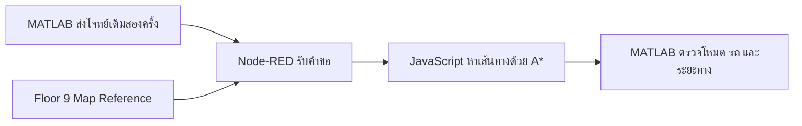

# Smart Factory AMR — คู่มืออ่านโค้ดและทดสอบระบบ

สำหรับผู้ดูแล Database และ Dashboard เริ่มจากกรณีทดสอบ MATLAB ที่รันได้แล้ว แล้วใช้แผนทดสอบหลายคันด้านล่างประกอบงานรอบถัดไป รายการฟีเจอร์ 1–6 ซอร์ส Node-RED อุปกรณ์รายฟีเจอร์ และ Map Backup อยู่ใน [AMR Handoff](roles/amr-handoff.md)

## เปิด MATLAB และทดสอบด้วยตัวเอง

บน Windows เปิด **MATLAB R2026b** จาก Start Menu หรือไอคอนได้โดยตรงหลังเปิดใช้งานครั้งแรก Node-RED AMR Lab รันใน Docker และเปิด Dashboard กับ API ได้แม้ปิด MATLAB สำหรับการทดสอบ ให้เปิดทั้ง Node-RED และ MATLAB โดย MATLAB เรียก API ผ่าน `127.0.0.1:1884` การตั้งค่าชุดเดิมใช้ MATLAB บน Windows และ Node-RED ใน Docker หากต้องการรวมขั้นตอนเป็นคลิกเดียวในอนาคต สามารถทำ Windows Shortcut ให้เรียก MATLAB แบบ `-batch` พร้อมสคริปต์ทดสอบได้

1. หาก Node-RED ยังไม่เปิด ให้เปิด Docker แล้วรันคำสั่งนี้จากโฟลเดอร์หลักของ repo ใน PowerShell

   ```powershell
   docker compose -f node-red/amr-lab/compose.yaml up -d
   ```

2. เปิด MATLAB จากไอคอน เลือกโฟลเดอร์ `node-red/amr-lab` ของ repo ในแถบ **Current Folder** หรือใช้ `cd` ใน **Command Window** โดยใส่พาธจริงของ repo บนเครื่องนั้น

   ```matlab
   cd('C:/path/to/smart-factory/node-red/amr-lab')
   check_matlab_node_red
   ```

   ถ้า Current Folder อยู่ที่ `node-red/amr-lab` แล้ว ให้พิมพ์ `check_matlab_node_red` ได้เลย ชื่อในคำสั่งใช้โดยไม่ใส่นามสกุล `.m` หากเรียก API ไม่ได้ ให้เปิด [Node-RED Editor](http://127.0.0.1:1884/) และตรวจว่ามีแท็บ **Capstone Floor 9 Reference** กับ **Capstone AMR Tap to Go** อยู่ใน runtime เดียวกัน

3. ผลที่ยืนยันบน MATLAB R2026b กับ `floor9-clean-plan-v1` เป็นการจำลอง AMR 1 คัน ทั้งสองคำขอใช้ต้นทางและปลายทางเดียวกัน

   | สถานะประตูในโจทย์ | ผลยืนยัน |
   |---|---:|
   | ไม่กำหนดให้ปิดประตู | 657 พิกเซล |
   | ปิด D-11 | 807 พิกเซล |

   เมื่อจบจะเห็น `Node-RED connected to MATLAB` และระยะทั้งสองค่า รอบที่รันแบบ batch จบด้วย exit code `0` ค่านี้เป็นระยะบนผังจำลอง ใช้ยืนยันการเชื่อมต่อและการหาเส้นทางอ้อมรายคัน

## อ่านโค้ดตามทางที่ข้อมูลไหล



| ไฟล์ | หน้าที่ |
|---|---|
| [check_matlab_node_red.m](../node-red/amr-lab/check_matlab_node_red.m) | `webread` อ่าน `/amr/maps` และรุ่นอ้างอิง `webwrite` ส่งคำขอทั้งสองกรณีไปยัง `/amr/tap-to-go/plan` `assert` ตรวจรุ่นแผนที่ โหมดจำลอง รถที่ตอบกลับ และระยะทางอ้อม `fprintf` พิมพ์ผล |
| [amr-tap-to-go.flow.json](../node-red/amr-lab/amr-tap-to-go.flow.json) | Node-RED รับคำขอ อ่านข้อมูล Floor 9 เรียกตัววางแผน แล้วคืนเส้นทางและระยะทาง |
| [tap-to-go-planner.cjs](../amr-route-lab/tap-to-go-planner.cjs) | JavaScript ใช้ A* หาเส้นทางจากตำแหน่งเริ่มถึงปลายทางบนกริด คำนวณทางผ่านจากกำแพง พื้นที่กีดขวาง และประตูที่ปิดในโจทย์ |
| [ข้อมูล Floor 9](../amr-route-lab/maps/floor9/README.md) | ภาพต้นฉบับ ชุดข้อมูลพิกัดประตู กำแพง ลิฟต์ บันได และภาพนำทางเก่าที่สำรองไว้ สำหรับการใช้กับรถจริงยังต้องสอบเทียบพิกัดแยกตามรถ |

## ปรับระบบจากผลศึกษา 5 คลิป

| แหล่ง | สิ่งที่นำมาใช้เทียบกับระบบเรา |
|---|---|
| [Multi-AMR Path Planning & Collision Avoidance](https://www.youtube.com/watch?v=RA3LGUIeR8Y) | คำบรรยายสาธิต A* หาเส้นทางรายคันเหมือนต้นแบบเรา และแยก D* Lite สำหรับวางใหม่เมื่อสิ่งกีดขวางเปลี่ยน, CBS สำหรับแก้เส้นทางขัดกัน และ ORCA สำหรับปรับการเคลื่อนที่เฉพาะหน้า |
| [SmartPass Obstacle Avoidance](https://www.youtube.com/watch?v=eHbFHbl2KkE) | ตัวอย่างผู้จัดการจราจรกลางที่กำกับการอ้อมสิ่งกีดขวางและการกลับเข้าเส้นเดิม แนวคิดการกำกับพื้นที่ใช้ร่วมกันใกล้กับแผนจองทางของเรา [คำอธิบายจาก BlueBotics](https://bluebotics.com/blog/does-ant-offer-obstacle-avoidance) |
| [Autonomous Robot Platoon System with ROS](https://www.youtube.com/watch?v=xGFWBUbK1zw) | ตรวจจากคำอธิบายคลิปและ README ว่าเป็น Pioneer 3DX เคลื่อนขบวนด้วย ROS ส่วนรายละเอียดโปรโตคอลระหว่างรถต้องตรวจจากรายงานหรือซอร์สเพิ่ม [ซอร์สผู้สร้าง](https://github.com/spagad7/Autonomous-Robot-Platoon-System) |
| [Odometry, IMU และ EKF](https://www.instagram.com/reels/DfhTVnHsW3g/) | คำอธิบายโพสต์และคลิปเต็มครอบคลุมการประมาณตำแหน่งรถ ซึ่งเป็นข้อมูลต้นทางของตัววางแผนและตัวจัดคิว [คลิปเต็มของผู้สร้าง](https://www.youtube.com/watch?v=fuXDk2Ti9jA) |
| [DiffusionDrive](https://www.instagram.com/reels/DgA6efmzViQ/) | คำอธิบายโพสต์และงานวิจัยพูดถึงโมเดลสร้างแนววิ่งสำหรับรถยนต์อัตโนมัติ ส่วนงาน ML ที่กำหนดไว้ใน Capstone คือประมาณเวลารอและเวลาถึงจากประวัติคิว [งานวิจัย CVPR 2025](https://openaccess.thecvf.com/content/CVPR2025/html/Liao_DiffusionDrive_Truncated_Diffusion_Model_for_End-to-End_Autonomous_Driving_CVPR_2025_paper.html) |

จากทั้งห้าแหล่ง รอบถัดไปให้ใช้ A* หาเส้นทางรายคันต่อ และเพิ่ม **การจองประตูหรือทางแคบใน Node-RED** ให้รถรายงาน ID ตำแหน่ง สถานะภารกิจ รุ่นแผนที่ และเวลาอัปเดต เก็บเหตุการณ์ขอจอง ยืนยันสิทธิ์ เข้า และออกใน Database อนุญาตให้รถเข้าได้ทีละคัน และให้รถถัดไปเข้าหลังยืนยันว่าคันก่อนออกแล้ว ถ้าข้อมูลขาดขณะอยู่ในช่วงทาง ให้ถือว่าช่วงนั้นยังอาจมีรถอยู่ แล้วแสดงเหตุผลที่คันถัดไปรอบน Dashboard

## ลำดับทดสอบรอบถัดไป

| ลำดับ | กรณีและเกณฑ์ที่ต้องตรวจ |
|---|---|
| **1. ตรวจระบบเดิม** | รันกรณี D-11 เปิดและปิดจาก MATLAB ให้ได้ผลในโหมดจำลองตามตารางด้านบน |
| **2. จองทางร่วม** | จำลองรถสองคันเข้าทางแคบจากคนละด้าน แล้วเพิ่มคันที่สามที่กำลังไปชาร์จ ตรวจว่าไม่มีการอนุญาตให้เข้าช่วงเดียวกันพร้อมกัน และ Dashboard ระบุได้ว่าคันไหนรอเพราะอะไร |
| **3. ทดสอบเมื่อสภาพเปลี่ยน** | ปิด D-11 ระหว่างรอ แล้วลองอีกกรณีให้รถในช่วงทางขาดการรายงาน ตรวจว่ารถคันอื่นรอหรืออ้อมตามข้อมูลที่มี และระบบยังถือพื้นที่เดิมไว้จนยืนยันว่าไม่มีรถอยู่ |
| **4. ตรวจ Fleet Schedule** | ให้ฟีเจอร์ 5 แสดง ETA ถึง A/B/C จากเวลาวิ่งรวมเวลารอทางหรือสถานี เทียบกับเวลาถึงจริงในซิมูเลชัน เส้นที่สั้นกว่าอาจถึงช้ากว่าเมื่อคิวใช้ทางนาน |
| **5. เปิดแผนกลับมาเทียบ** | ให้ฟีเจอร์ 6 เปิด Workflow ที่บันทึกไว้แล้วนำไปจำลองใน MATLAB เทียบเวลาจบงาน เวลารอ และจำนวนงานที่เสร็จภายใต้สมมติฐานที่ระบุ ผู้ใช้เลือกแผนเองหลังเห็นผล |

ข้อ 2–5 เป็นงานที่จะพัฒนาและทดสอบต่อ ทีม Database ดูแลข้อมูลการจองและชุดจำลอง ทีม Dashboard แสดงคิว เหตุผลที่รอ ETA และผลเปรียบเทียบ ใช้ **MATLAB** ทำการทดสอบที่รันซ้ำได้และเทียบผล หากต้องลงรายละเอียดการเร่ง เบรก หรือตัวควบคุมจึงพิจารณา **Simulink**

**ML และ LLM ตามมาหลังทดสอบคิวพื้นฐานได้** ใช้ ML ประมาณเวลารอเมื่อเก็บข้อมูลจริงพอ และวัดความแม่นเทียบกับค่าประมาณพื้นฐาน ใช้ LLM ตอบคำถามสถานะหรือ ETA ใน LINE จากข้อมูลที่ Node-RED มี พร้อมเวลาที่อัปเดต ส่วน Alarm ให้ Node-RED ส่งตามเงื่อนไขที่ตั้งไว้
